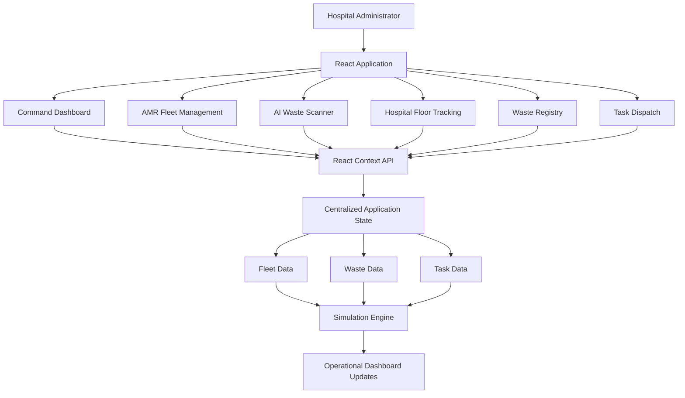

# MedRoute AI
<div align="center">

### Autonomous Biomedical Waste Command & Segregation Platform

**Smarter Waste Management. Safer Hospitals. Sustainable Healthcare.**

An intelligent hospital waste management platform integrating AI-powered classification, Autonomous Mobile Robots (AMRs), and digital waste traceability.

<br/>

[](https://react.dev/)
[](https://vite.dev/)
[](https://developer.mozilla.org/en-US/docs/Web/JavaScript)
[](https://en.wikipedia.org/wiki/Computer_vision)
[](https://render.com/)

<br/>

**[Explore Repository](https://github.com/Mohit-Sable/MedRoute) · [Report an Issue](https://github.com/Mohit-Sable/MedRoute/issues)**

</div>

---

## Overview

**MedRoute AI** is an intelligent biomedical waste management platform designed to modernize hospital waste collection, segregation, monitoring, and traceability.

Traditional biomedical waste management relies heavily on manual processes, creating challenges related to hazardous exposure, segregation errors, inefficient collection schedules, and limited operational visibility.

MedRoute AI introduces a centralized command-and-control system that combines AI-assisted waste classification, autonomous robot fleet supervision, interactive hospital navigation, and digital waste passports.

The platform demonstrates how intelligent automation and connected healthcare infrastructure can make biomedical waste management safer, more efficient, and transparent.

## The Problem

Hospitals generate different categories of biomedical waste every day. Improper segregation and handling can create serious health, environmental, and operational risks.

| Challenge | Impact |
|---|---|
| Manual waste collection | Increased biohazard exposure |
| Incorrect segregation | Cross-contamination and compliance risks |
| Fixed collection schedules | Inefficient resource utilization |
| Limited monitoring | Lack of operational visibility |
| Paper-based tracking | Difficulties in waste traceability |

## Our Solution

MedRoute AI provides an integrated waste management ecosystem through:

- AI-assisted biomedical waste identification.
- Autonomous Mobile Robot (AMR) fleet management.
- Interactive hospital floor tracking.
- Dynamic waste collection and task dispatch.
- Multi-compartment segregation monitoring.
- Digital Waste Passport generation.
- End-to-end chain-of-custody tracking.
- Operational analytics and compliance monitoring.

---

## Core Features

### 01. Command & Control Dashboard

A centralized interface for monitoring hospital waste management operations.

- Waste collection statistics.
- Segregation compliance indicators.
- Active robot fleet monitoring.
- Pending collection tasks.
- Operational activity logs.
- Critical alerts and notifications.

### 02. Autonomous Robot Fleet Management

Monitor and supervise autonomous waste collection robots.

- Individual robot status monitoring.
- Battery and payload tracking.
- Navigation state visualization.
- Sensor diagnostics.
- Multi-compartment payload monitoring.
- Emergency Stop controls.

### 03. Interactive Hospital Navigation

A visual hospital environment for monitoring robot movement.

- Interactive SVG-based floor maps.
- Multi-floor visualization.
- Robot movement and route visualization.
- SLAM trajectory simulation.
- Obstacle avoidance visualization.
- Department-level monitoring.

### 04. AI-Powered Waste Classification

An image-based interface for identifying biomedical waste categories.

| Waste Category | Segregation Color |
|---|---|
| Infectious waste | Yellow |
| Anatomical waste | Yellow |
| Cytotoxic waste | Yellow |
| Contaminated recyclable plastics | Red |
| Sharps | White Translucent |
| Glassware | Blue |

Additional capabilities:

- Image upload and classification interface.
- Preset sample images.
- Confidence score visualization.
- Low-confidence classification warnings.
- Waste segregation recommendations.

### 05. Biomedical Waste Registry

A centralized registry for managing waste collection records.

- Unique waste identification.
- Department-wise tracking.
- Waste category and weight.
- Collection timestamps.
- Processing status.
- Search and filtering.
- CSV report export.

### 06. Dynamic Task Dispatch

An operational interface for coordinating collection activities.

- Create waste collection tasks.
- Assign priorities.
- Select hospital departments.
- Dispatch available robots.
- Monitor task progress.
- Manage fleet availability.

### 07. Operational Analytics

Data-driven insights for hospital waste management.

- Waste generation trends.
- Category-wise waste distribution.
- Department-level analytics.
- Robot utilization.
- Collection task completion.
- Compartment fill-level monitoring.
- CSV reporting.

### 08. Digital Waste Passport

A digital traceability mechanism that assigns a unique identity to every waste batch.

Each passport contains:

- Unique Waste ID.
- SHA-256 verification hash.
- QR-based identification.
- Waste category and origin.
- Collection and transfer information.
- Chronological custody records.

**Waste Traceability Workflow**

<div align="center">

```text
  WASTE GENERATION
         |
         v
  AI IDENTIFICATION
         |
         v
   AMR ASSIGNMENT
         |
         v
  WASTE COLLECTION
         |
         v
   VAULT TRANSFER
         |
         v
   FINAL DISPOSAL
         |
         v
  DIGITAL AUDIT LOG
```

</div>

### 09. Safety & System Configuration

- Critical and warning alerts.
- Audio notifications.
- Configurable compartment thresholds.
- Fleet simulation controls.
- Emergency Stop functionality.
- Hospital configuration settings.

---

## Technology Stack

<div align="center">

| Layer | Technologies |
|:---:|---|
| Frontend | React 19, Vite 8 |
| Language | JavaScript ES6+ |
| Styling | CSS |
| Icons | Lucide React |
| State Management | React Context API |
| Visualization | SVG |
| Browser APIs | Web Audio API |
| Deployment | Render |

</div>

## System Architecture

<div align="center">



</div>

## Project Structure

```text
MedRoute/
│
├── public/
│   └── Static assets
│
├── src/
│   ├── assets/
│   │
│   ├── components/
│   │   ├── layout/
│   │   └── views/
│   │
│   ├── context/
│   │   └── AppContext.jsx
│   │
│   ├── data/
│   │   └── mockData.js
│   │
│   ├── App.jsx
│   ├── index.css
│   └── main.jsx
│
├── .env.example
├── .gitignore
├── index.html
├── package.json
├── render.yaml
├── vite.config.js
└── README.md
```

## Getting Started

### Prerequisites

- Node.js 18+
- npm 9+
- Git

### Installation

**1. Clone the repository**

```bash
git clone https://github.com/Mohit-Sable/MedRoute.git
```

**2. Navigate to the project**

```bash
cd MedRoute
```

**3. Install dependencies**

```bash
npm install
```

**4. Start the development server**

```bash
npm run dev
```

**5. Open in browser**

```text
http://localhost:5173
```

### Production Build

```bash
npm run build
```

### Preview Production Build

```bash
npm run preview
```

The optimized production files will be generated in the `dist/` directory.

## Deployment

The project supports deployment as a Render Static Site.

| Configuration | Value |
|---|---|
| Service Type | Static Site |
| Build Command | `npm install && npm run build` |
| Publish Directory | `dist` |
| Rewrite Source | `/*` |
| Rewrite Destination | `/index.html` |

For deployment, connect the GitHub repository to [Render](https://render.com/) and configure the build settings.

---

## Current Implementation & Limitations

MedRoute AI is currently a software-based operational prototype.

The following functionalities are demonstrated through frontend simulations:

- Autonomous robot navigation and movement.
- LiDAR SLAM and obstacle avoidance telemetry.
- Robot battery and sensor readings.
- AI waste classification workflow.
- Confidence score visualization.
- Waste collection and transfer operations.
- Fleet monitoring and task dispatch.

The classification interface is not currently connected to a validated production AI inference model. Physical AMR integration, real-time sensors, and hospital infrastructure connectivity are future development requirements.

**The platform is a prototype and is not intended to replace certified biomedical waste handling procedures or safety systems.**

## Future Roadmap

- [ ] Physical AMR hardware integration.
- [ ] ROS 2 autonomous navigation.
- [ ] Real-time LiDAR and depth camera integration.
- [ ] YOLO-based biomedical waste classification.
- [ ] IoT-enabled smart waste bins.
- [ ] Cloud-based fleet monitoring.
- [ ] Hospital ERP integration.
- [ ] Predictive waste collection scheduling.
- [ ] Advanced compliance analytics.
- [ ] Production-grade digital traceability.

## Project Objectives

1. Reduce human exposure to hazardous biomedical waste.
2. Improve biomedical waste segregation accuracy.
3. Optimize hospital waste collection workflows.
4. Improve operational visibility through centralized monitoring.
5. Enable digital waste traceability.
6. Demonstrate intelligent automation in healthcare infrastructure.

---

## Author

<div align="center">

### Mohit Sable

**Full-Stack Developer | Technology Enthusiast**

[](https://github.com/Mohit-Sable)

[View Project Repository](https://github.com/Mohit-Sable/MedRoute)

</div>

---

<div align="center">

### Building Safer Healthcare Through Intelligent Automation.

**If you find this project interesting, consider giving it a ⭐**

</div>
